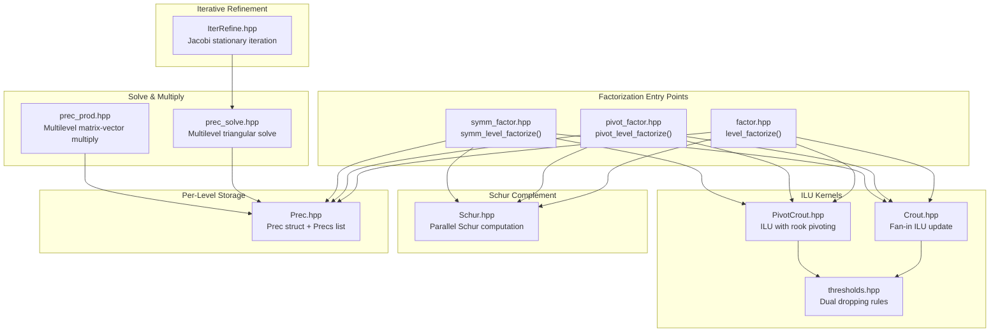

# Algorithms Module (`alg/`)

> **Source**: `src/hif/alg/`
> **Dependencies**: `ds/` (CRS, CCS, AugCRS, AugCCS, DenseMatrix, SparseVec, PermMatrix), `pre/` (preprocessing driver), `small_scale/` (dense solvers), `utils/` (logging, math, timing, threading)

## 1. Overview

The `alg/` module implements the core numerical algorithms of HIFIR: incomplete
LU factorization (three variants), Schur complement computation, multilevel
triangular solve, matrix-vector multiply, and iterative refinement.



## 2. Factorization Variants

HIFIR provides three factorization paths, selected by `Options::is_symm` and
`Options::pivot`:

| Variant | File | Entry Function | When Used |
|---------|------|----------------|-----------|
| **Standard ILU** | `factor.hpp` | `level_factorize<IsSymm>()` | Default; `pivot=OFF` or `pivot=AUTO` (first attempt) |
| **Pivoting ILU** | `pivot_factor.hpp` | `pivot_level_factorize()` | `pivot=ON` or `pivot=AUTO` fallback (when $m < 0.25 m_0$) |
| **Symmetric LDL^T** | `symm_factor.hpp` | `symm_level_factorize()` | `is_symm=1` |

### 2.1 Standard ILU (`level_factorize`)

**File**: `factor.hpp` (~1310 lines)

The primary factorization path. Computes a single level of the multilevel
incomplete factorization:

```
Input:  Sparse matrix A (CRS or CCS), Options opts, leading block size m0
Output: Prec level (L_B, d_B, U_B, E, F, s, t, p, q) + Schur complement S
```

**Per-level pipeline:**

1. **Determine symmetry**: Compute pattern symmetry ratio; if above `nzp_thres` (0.65), use symmetric preprocessing
2. **Preprocessing**: Call `do_preprocessing()` — matching/scaling + AMD/RCM reordering
3. **Extract permuted diagonal**: Apply permutations to diagonal entries
4. **Allocate L (CCS) and U (CRS)**: Pre-allocate with `HIF_RESERVE_FAC` (default: 5x) reserve
5. **Crout ILU loop** (steps 0 to m-1):
   - Check diagonal quality → defer if $|1/d_{ii}| > \kappa_d$
   - Check inverse-norm conditioning → defer if $\kappa > \text{kappa}$
   - Compute $u_t$ (row of U) via `compute_ut()`
   - Compute $l$ (column of L) via `compute_l()`
   - Update remaining diagonal via `update_diag()`
   - Apply dual dropping (inverse-based + scalability-oriented)
   - Sort indices and push to L/U storage
6. **Compress tails**: Finalize L/U storage, rebuild permutations
7. **Analyze deferral ratio**: Set `post_flag` if too many deferrals
8. **Schur complement**: Compute $S = A_{22} - A_{21} A_{11}^{-1} A_{12}$ (OpenMP parallel)
9. **Extract E/F**: Off-diagonal blocks from split L/U
10. **Assemble Prec**: `precs.emplace_back(m, n, L_B, d, U_B, E, F, s, t, p, q)`
11. **Dense last level**: If Schur is small enough ($\leq$ `dense_thres`), convert to dense and factorize with QRCP/LUP
12. **Recurse**: Return Schur complement for next level

### 2.2 Pivoting ILU (`pivot_level_factorize`)

**File**: `pivot_factor.hpp` (~762 lines)

Uses inverse-based rook pivoting (IBRP) to improve numerical stability.
The pivoting strategy selects pivot elements that satisfy both row and column
inverse-norm bounds simultaneously.

**Key difference from standard ILU**: The Crout update is replaced by
`PivotCrout` which maintains a pivot candidate set and performs row/column
interchanges when better pivots are found.

### 2.3 Symmetric LDL^T (`symm_level_factorize`)

**File**: `symm_factor.hpp` (~680 lines)

For symmetric/Hermitian systems, computes $A \approx LDL^T + S$ where:
- $L$ is unit lower triangular
- $D$ is diagonal (real for Hermitian)
- $S$ is the Schur complement

The symmetric variant uses only the lower (or upper) triangle and enforces
$U = L^T$ (or $U = L^H$), halving the storage and computation.

## 3. Crout ILU Kernel

**File**: `Crout.hpp`

The Crout update is the inner loop of the factorization. At step $k$, it
computes the $k$-th row of $U$ and $k$-th column of $L$ from the current
Schur complement.

### Fan-in ILU Algorithm

```
For step k = 0, 1, ..., m-1:
  1. Scatter row k of A into workspace (sparse vector)
  2. For each j < k where L(j,k) != 0:
       u_t -= L(j,k) * U(j, k+1:n)    // fan-in update for U row
  3. For each j < k where U(k,j) != 0:
       l -= U(k,j) * L(k+1:n, j)      // fan-in update for L column
  4. d = workspace[k]                  // diagonal entry
  5. l /= d                            // scale L column
  6. Apply dropping to u_t and l
  7. Gather u_t into U, l into L
  8. Update remaining diagonal entries
```

### Workspace Usage

The Crout kernel uses `SparseVector` (from `ds/`) as its primary workspace:
- **Dense value array**: O(n) array for scatter/gather operations
- **Sparse index array**: Tracks active positions
- **Tag array**: O(1) membership testing without clearing

### Key Functions

| Function | Purpose |
|----------|---------|
| `compute_ut()` | Compute row of U via fan-in from previous L columns |
| `compute_l()` | Compute column of L via fan-in from previous U rows |
| `scale_inv_diag()` | Scale L column by inverse diagonal |
| `update_diag()` | Update remaining diagonal after step k |
| `update_compress()` | Apply dropping and compress result into storage |

## 4. Dual Dropping Strategy

**File**: `thresholds.hpp`

HIFIR applies two complementary dropping rules to control fill-in:

### 4.1 Inverse-Based Dropping (Numerical)

Drops entries based on the inverse of the triangular factors, which bounds
the perturbation to the factorization:

$$|l_{ij}| \leq \tau_L \cdot \|U_j^{-1}\|^{-1} \quad \text{(drop from L)}$$
$$|u_{ij}| \leq \tau_U \cdot \|L_i^{-1}\|^{-1} \quad \text{(drop from U)}$$

Controlled by `tau_L`, `tau_U` (default: 1e-4) and `kappa` (default: 3.0).

### 4.2 Scalability-Oriented Dropping (Space)

Limits the number of entries per column (L) or per row (U) to
$\alpha \cdot \text{nnz}_{\text{avg}}$ largest-magnitude entries:

$$\text{keep top } \lfloor \alpha_L \cdot \bar{n}_L \rfloor \text{ entries per column of L}$$
$$\text{keep top } \lfloor \alpha_U \cdot \bar{n}_U \rfloor \text{ entries per row of U}$$

Controlled by `alpha_L`, `alpha_U` (default: 10.0). Uses `std::nth_element`
for O(n) selection.

### 4.3 Combined Application

Both rules are applied simultaneously: an entry survives only if it passes
**both** the inverse-based threshold **and** the space-based limit.

## 5. Schur Complement

**File**: `Schur.hpp`

After the Crout loop processes $m$ steps, the remaining $(n-m) \times (n-m)$
submatrix is updated to form the Schur complement:

$$S = A_{22} - L_E \cdot D \cdot U_F$$

where:
- $A_{22}$ is the trailing submatrix
- $L_E$ is the lower off-diagonal block of L (rows $m+1:n$, columns $1:m$)
- $U_F$ is the upper off-diagonal block of U (rows $1:m$, columns $m+1:n$)
- $D$ is the diagonal of the leading block

### Parallel Computation

The Schur complement is computed in parallel using OpenMP:
- Each thread processes a subset of rows of $S$
- The computation is embarrassingly parallel since each row of $S$ is independent
- Thread count is controlled by `Options::threads` or `HIF_NUM_THREADS` env var

### Dropping on L_E / U_F

Before computing the Schur complement, dropping is applied to $L_E$ and $U_F$
to control the density of $S$. This can be disabled with `HIF_NO_DROP_LE_UF`.

## 6. Prec — Per-Level Storage

**File**: `Prec.hpp` (~362 lines)

The `Prec` struct stores one level of the multilevel factorization:

```cpp
struct Prec {
    size_type m;           ///< Leading block size
    size_type n;           ///< System size at this level
    ccs_type  L_B;         ///< Lower triangular (leading block)
    array_type d_B;        ///< Diagonal
    ccs_type  U_B;         ///< Upper triangular (leading block)
    ccs_type  E;           ///< Off-diagonal block (L part)
    ccs_type  F;           ///< Off-diagonal block (U part)
    array_type s;          ///< Row scaling
    array_type t;          ///< Column scaling
    iarray_type p, p_inv;  ///< Row permutation + inverse
    iarray_type q, q_inv;  ///< Column permutation + inverse
    sss_solver_type dense_solver;      ///< Dense solver (last level)
    sss_symm_solver_type symm_dense_solver;  ///< Symmetric dense solver
};
```

### Precs Container

```cpp
using Precs = std::list<Prec<ValueType, IndexType, IndPtrType, UserDenseFactor>>;
```

A `std::list` (linked list) is used instead of `std::vector` to avoid
reallocation during recursive level construction. Each level is
`emplace_back`'d as it is computed.

### Dense Solver Integration

The dense solver type is resolved at compile time via `SmallScaleSolverTrait`:
- `HIF_DENSE_MODE=1` (default): Uses `QRCP` (rank-revealing QR)
- `HIF_DENSE_MODE≠1`: Uses `LUP` (LU with partial pivoting)
- Symmetric systems: Always uses `SYEIG` (eigendecomposition)

Users can customize via the `UserDenseFactor` template parameter or by
specializing `DefaultDenseSolver<T>`.

## 7. Multilevel Triangular Solve

**File**: `prec_solve.hpp` (~634 lines)

`prec_solve()` and `prec_solve_tran()` traverse all levels to compute
$x = M^{-1} b$ where $M$ is the multilevel preconditioner.

### Forward Sweep (Level 1 → Last)

At each level:
1. **Apply scaling**: $b' = S \cdot P \cdot b$ (row scaling + permutation)
2. **Forward solve**: $L_B \cdot y = b'$ (unit lower triangular)
3. **Diagonal solve**: $D \cdot z = y$
4. **Back solve**: $U_B \cdot w = z$ (unit upper triangular)
5. **Schur contribution**: Compute $E/F$ terms and pass residual to next level

### Last Level

The last level uses the dense solver (QRCP/LUP/SYEIG) to solve the
dense Schur complement system.

### Backward Sweep (Last → Level 1)

Back-substitute through all levels in reverse order, accumulating the
off-diagonal contributions from $E$ and $F$.

## 8. Multilevel Matrix-Vector Multiply

**File**: `prec_prod.hpp`

`prec_prod()` and `prec_prod_tran()` compute $y = M \cdot x$ where $M$ is
the multilevel preconditioner. This is the forward application of the
factorization, used in residual computation and eigenvalue estimation.

## 9. Iterative Refinement

**File**: `IterRefine.hpp` (~190 lines)

`IterRefine` implements Jacobi stationary iteration with the HIF preconditioner:

$$x_{k+1} = x_k + G(b - Ax_k)$$

where $G$ is applied via `prec_solve()`.

### Convergence

For nonsingular systems, the iteration converges when $\|I - GA\| < 1$.
For singular systems, the iteration converges to the null-space component
when combined with null space filtering.

### Bounded Variant

The `hifir()` method with `betas` parameter checks the relative residual
$\|r_k\| / \|b\|$ against lower and upper bounds, returning early when
the residual is within the acceptable range.

## 10. Cross-Module Dependencies

| From `alg/` | To Module | What |
|-------------|-----------|------|
| `factor.hpp`, `pivot_factor.hpp`, `symm_factor.hpp` | `pre/` | `do_preprocessing()` |
| `Crout.hpp`, `PivotCrout.hpp` | `ds/` | `AugCRS`, `AugCCS`, `SparseVector` |
| `Schur.hpp` | `ds/` | `CRS`, `CCS`, `Array` |
| `Prec.hpp` | `small_scale/` | `SmallScaleSolverTrait`, `QRCP`, `LUP`, `SYEIG` |
| `Prec.hpp` | `ds/` | `CCS`, `DenseMatrix`, `PermMatrix` |
| `prec_solve.hpp`, `prec_prod.hpp` | `ds/` | `Array`, `CCS` |
| `IterRefine.hpp` | `utils/` | `math.hpp` (norms), `mv_helper.hpp` |
| All | `utils/` | `log.hpp`, `Timer.hpp`, `common.hpp` |
