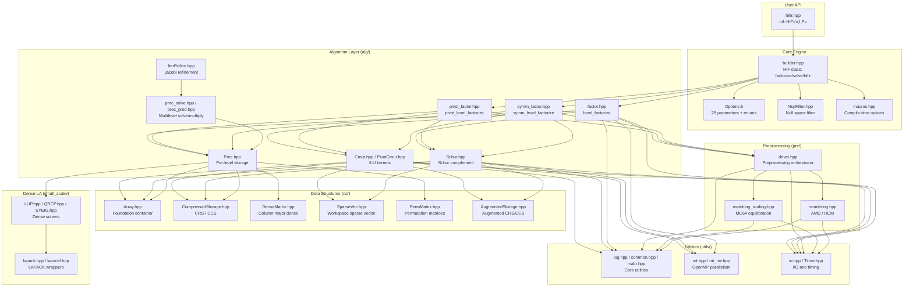
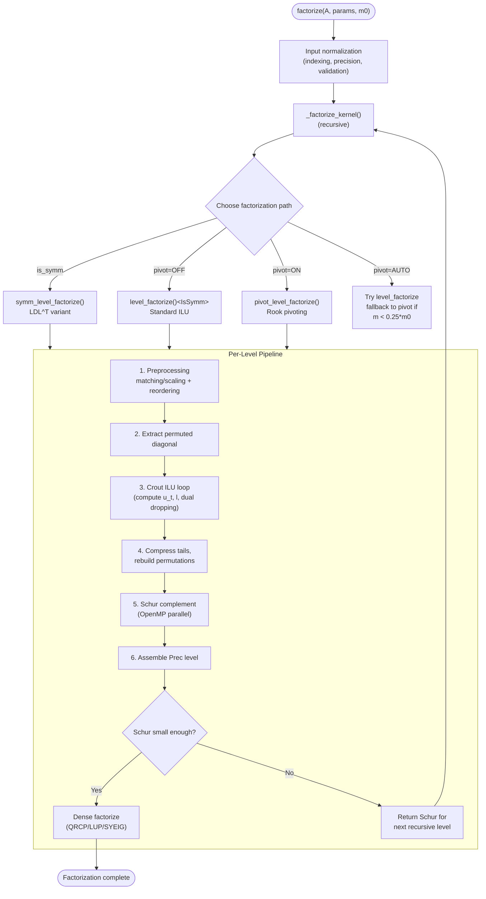
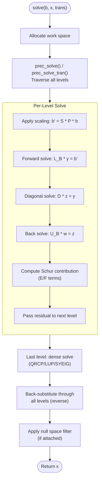

# HIFIR Overall Design

> **Reference**: Q. Chen and X. Jiao, "HIFIR: Hybrid Incomplete Factorization with Iterative Refinement," 2021. [arXiv:2106.09877](https://arxiv.org/abs/2106.09877)

## 1. Purpose and Scope

HIFIR is a multilevel preconditioner for ill-conditioned and nearly singular sparse
linear systems. It computes a hybrid incomplete factorization with iterative
refinement (HIFIR) that serves as a robust preconditioner for Krylov subspace
methods and as a standalone solver for singular systems.

The library targets systems $Ax = b$ where $A \in \mathbb{R}^{n \times n}$ (or
$\mathbb{C}^{n \times n}$) is sparse and possibly ill-conditioned or rank-deficient.
HIFIR constructs a multilevel approximate generalized inverse (AGI) $G$ such that
$x \approx Gb$ is a least-squares solution.

## 2. Theoretical Foundations

### 2.1 Approximate Generalized Inverse (AGI)

An $\varepsilon$-accurate AGI of $A$ is an operator $G$ satisfying:

$$\|AGx - P_{\mathcal{R}(A)} x\| \leq \varepsilon \|x\| \quad \forall x$$

where $P_{\mathcal{R}(A)}$ is the orthogonal projector onto the range of $A$.
When $\varepsilon$ is small, $G$ acts as an approximate right inverse on the
range of $A$.

### 2.2 Optimal Right-Preconditioning

The optimal right-preconditioning operator minimizes $\kappa(AM)$ over all
nonsingular $M$. HIFIR approximates this by constructing a multilevel
factorization $A \approx LDU + S$ where $S$ captures the Schur complement
contribution from deferred rows/columns.

### 2.3 Variable Preconditioning via Iterative Refinement

For rank-deficient systems, HIFIR uses iterative refinement with variable
preconditioning:

$$v_j = (I - GA) v_{j-1} + Gq$$

where $G$ is the AGI and $q$ is the right-hand side. This converges to the
null-space component of the solution.

## 3. Architecture Overview



### 3.1 Module Responsibilities

| Module | Location | Responsibility |
|--------|----------|----------------|
| **Top-level API** | `src/hifir.hpp`, `src/hif/builder.hpp` | User-facing `HIF` class with `factorize()`, `solve()`, `hifir()`, `mmultiply()` |
| **Options** | `src/hif/Options.h` | 28-parameter configuration struct with C/C++ interfaces |
| **NspFilter** | `src/hif/NspFilter.hpp` | Null space filtering (constant, user-override, callback) |
| **Macros** | `src/hif/macros.hpp` | Compile-time options (`HIF_DENSE_MODE`, `HIF_RESERVE_FAC`, etc.) |
| **alg/** | `src/hif/alg/` | Core algorithms: Crout ILU, Schur complement, multilevel solve, iterative refinement |
| **pre/** | `src/hif/pre/` | Preprocessing: equilibration (MC64), scaling, AMD/RCM reordering |
| **ds/** | `src/hif/ds/` | Data structures: Array, CRS/CCS, DenseMatrix, SparseVec, PermMatrix |
| **small_scale/** | `src/hif/small_scale/` | Dense linear algebra: LUP, QRCP, SYEIG via LAPACK |
| **utils/** | `src/hif/utils/` | Logging, type traits, math, I/O, threading, timing |

### 3.2 Template Architecture

```cpp
template <class ValueType,           // double, float, complex<double>, etc.
          class IndexType = int,     // column/row index type
          class IndPtrType = std::ptrdiff_t,  // row/column pointer type
          template <class> class UserDenseFactor = DefaultDenseSolver>
class HIF;
```

The four template parameters allow:
- **ValueType**: Support for real (`float`, `double`) and complex (`std::complex<T>`) arithmetic
- **IndexType**: Typically `int` (32-bit); can be `int64_t` for very large systems
- **IndPtrType**: `std::ptrdiff_t` by default (v0.2.0 breaking change from `int`)
- **UserDenseFactor**: Compile-time customization of the dense solver backend

## 4. Factorization Workflow

The factorization constructs a multilevel preconditioner through recursive
incomplete LU factorization with deferral.



### 4.1 Per-Level Factorization

At each level, the algorithm computes:

$$P \cdot S \cdot A \cdot T \cdot Q \approx \begin{bmatrix} L_B & 0 \\ L_E & I \end{bmatrix} \begin{bmatrix} D & 0 \\ 0 & \tilde{S} \end{bmatrix} \begin{bmatrix} U_B & U_F \\ 0 & I \end{bmatrix}$$

where:
- $P, Q$ are row/column permutation matrices (from reordering)
- $S, T$ are diagonal scaling matrices (from equilibration)
- $L_B, D, U_B$ form the leading block LDU factorization
- $L_E, U_F$ are off-diagonal blocks
- $\tilde{S}$ is the Schur complement for the next level

### 4.2 Dual Dropping Strategy

The Crout ILU loop applies two complementary dropping rules:

1. **Inverse-based dropping** (numerical): Entries with $|l_{ij}| > \tau_L \cdot \kappa(U_j)$ or $|u_{ij}| > \tau_U \cdot \kappa(L_i)$ are dropped. Controlled by `tau_L`, `tau_U`, `kappa`.

2. **Scalability-oriented dropping** (space): Per-column (L) or per-row (U) fill is limited to $\alpha \cdot \text{nnz}_{\text{avg}}$ largest entries. Controlled by `alpha_L`, `alpha_U`.

### 4.3 Dynamic Deferral

Rows/columns are deferred to the Schur complement when:
- **Bad diagonal**: $|1/d_{ii}| > \kappa_d$ (diagonal too small)
- **Bad conditioning**: Inverse-norm exceeds $\kappa$ threshold

Deferred entries form the Schur complement, which is factorized recursively at the next level.

### 4.4 Pivoting Strategy (PIVOTING_AUTO)

The `AUTO` pivoting mode implements a hybrid strategy:
1. Attempt factorization without pivoting (`level_factorize`)
2. If leading block size $m < 0.25 \cdot m_0$ (excessive deferrals), re-run with inverse-based rook pivoting (`pivot_level_factorize`)

## 5. Solve Workflow



## 6. Iterative Refinement (HIFIR)

For singular or nearly singular systems, HIFIR wraps the preconditioner in
iterative refinement:

$$x_0 = 0, \quad x_{k+1} = x_k + G(b - Ax_k)$$

where $G$ is the multilevel preconditioner applied via `solve()`.

The bounded variant checks $\|r_k\| / \|b\|$ against user-specified thresholds
`betas[0]` (lower) and `betas[1]` (upper), returning early if satisfied.

## 7. Key Design Decisions

| Decision | Rationale |
|----------|-----------|
| **Header-only C++** | Zero build dependency for the core library; users just `#include "hifir.hpp"` |
| **C++11 standard** | Maximum portability; no C++14/17 features |
| **Template-based** | Support `float`, `double`, `complex<T>` without code duplication |
| **LAPACK-only dependency** | Minimize external dependencies; BLAS accessed only through LAPACK |
| **OpenMP for Schur** | Parallel Schur complement construction; optional via `USE_OPENMP` |
| **Recursive multilevel** | Natural handling of rank deficiency through deferral |
| **Dual dropping** | Balance numerical accuracy (inverse-based) with memory control (space-based) |
| **QRCP default for dense** | Rank-revealing factorization handles singular dense Schur complements |
| **`std::list<Prec>`** | Linked list avoids reallocation during recursive level construction |

## 8. Module Design Documents

Detailed design for each module:

- [Data Structures (`ds/`)](ds/design.md) — Array, CRS/CCS, DenseMatrix, SparseVec, PermMatrix
- [Algorithms (`alg/`)](alg/design.md) — Crout ILU, Schur complement, multilevel solve, iterative refinement
- [Preprocessing (`pre/`)](pre/design.md) — Equilibration, scaling, AMD/RCM reordering
- [Dense Linear Algebra (`small_scale/`)](small_scale/design.md) — LUP, QRCP, SYEIG via LAPACK
- [Utilities (`utils/`)](utils/design.md) — Logging, type traits, math, I/O, threading
