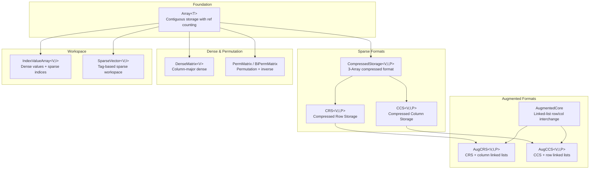
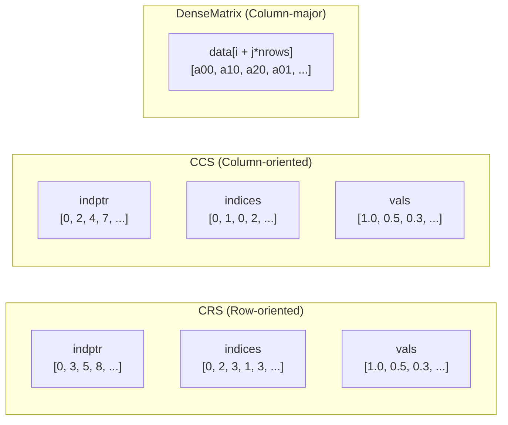

# Data Structures Module (`ds/`)

> **Source**: `src/hif/ds/`
> **Dependencies**: `utils/common.hpp`, `utils/log.hpp`, `utils/math.hpp`, `utils/io.hpp`, `utils/coo2compress.hpp`, `utils/mt_mv.hpp`

## 1. Overview

The `ds/` module provides the foundational data structures for sparse and dense
linear algebra throughout HIFIR. The design follows a layered hierarchy where
each layer builds upon the one below, enabling efficient memory management,
shallow copying, and external data wrapping.



## 2. Array\<T\> — Foundation Container

**File**: `Array.hpp`

`Array<T>` is the foundational container for all contiguous data in HIFIR.
It wraps a raw pointer with size and capacity, supporting three ownership modes:

| Mode | Description | Use Case |
|------|-------------|----------|
| **Owned** | Array allocates and owns memory | Standard internal storage |
| **External** | Array wraps user-provided pointer (no deallocation) | Interop with external data (e.g., Fortran arrays) |
| **Shallow copy** | Copy constructor increments reference count | Efficient pass-by-value without deep copy |

### Key Design Decisions

- **Reference counting**: Uses `std::shared_ptr<size_t>` for ref count. When count drops to zero, memory is freed.
- **`IndPtrType`**: Uses `std::ptrdiff_t` (not `size_t`) for index pointer type — this was a breaking change in v0.2.0.
- **Move semantics**: Full move constructor/assignment support for zero-copy transfers.
- **`destroy()`**: Explicit cleanup that decrements ref count and frees if last owner.

### Core API

```cpp
Array<T>(size_type n);                    // Allocate n elements
Array<T>(T* data, size_type n);           // Wrap external data (non-owning)
Array<T>(const Array& other);             // Shallow copy (ref count++)
Array<T>(Array&& other);                  // Move (transfer ownership)
void resize(size_type n);                 // Resize (may reallocate)
void push_back(const T& val);             // Append (amortized O(1))
T& operator[](size_type i);              // Element access
void destroy();                           // Explicit cleanup
```

## 3. CompressedStorage\<V, I, P\> — Base Sparse Format

**File**: `CompressedStorage.hpp`

`CompressedStorage` is the abstract base for all compressed sparse matrix formats.
It stores three `Array` objects:

| Array | Type | Content |
|-------|------|---------|
| `indptr` | `Array<P>` | Row/column pointers (size: nrows+1 or ncols+1) |
| `indices` | `Array<I>` | Column/row indices (size: nnz) |
| `vals` | `Array<V>` | Nonzero values (size: nnz) |

### Template Parameters

| Parameter | Default | Description |
|-----------|---------|-------------|
| `V` | — | Value type (`double`, `complex<double>`, etc.) |
| `I` | `int` | Index type for column/row indices |
| `P` | `std::ptrdiff_t` | Pointer type for `indptr` array |

### CRS and CCS

`CRS<V,I,P>` and `CCS<V,I,P>` inherit from `CompressedStorage` and add:

- **CRS** (Compressed Row Storage): `indptr[i]` to `indptr[i+1]` gives the range of nonzeros in row `i`. Efficient for row access and SpMV.
- **CCS** (Compressed Column Storage): `indptr[j]` to `indptr[j+1]` gives the range of nonzeros in column `j`. Efficient for column access.

Both support:
- `multiply(x, y, tran)` — Sparse matrix-vector product
- `read_mm(fname)` / `write_mm(fname)` — Matrix Market I/O
- `nrows()`, `ncols()`, `nnz()` — Dimension queries
- `make_alias(nrows, ncols, indptr, indices, vals)` — Wrap external data

## 4. AugmentedStorage — Linked-List Interchange Format

**File**: `AugmentedStorage.hpp`

`AugCRS<V,I,P>` and `AugCCS<V,I,P>` extend CRS/CCS with linked-list structures
for efficient row/column interchange during the Crout ILU factorization.

### Design Rationale

During Crout factorization, entries are dynamically inserted into rows (for U)
or columns (for L). Standard CRS/CCS requires O(nnz) shifts for insertion.
The augmented formats maintain per-row (AugCCS) or per-column (AugCRS) linked
lists that allow O(1) insertion.

### AugmentedCore

`AugmentedCore` provides the linked-list infrastructure:

- **Head array**: Points to the first entry in each row/column linked list
- **Next array**: Links entries within the same row/column
- **Tag array**: Marks entries for O(1) lookup during Crout updates

### Multiple Inheritance

```cpp
class AugCRS : public CRS<V,I,P>, public AugmentedCore { ... };
class AugCCS : public CCS<V,I,P>, public AugmentedCore { ... };
```

The `AugmentedCore` is mixed in via multiple inheritance, keeping the
linked-list logic separate from the compressed storage logic.

## 5. DenseMatrix\<V\> — Column-Major Dense Storage

**File**: `DenseMatrix.hpp`

`DenseMatrix<V>` stores a dense matrix in column-major order (Fortran convention),
which is required for direct interoperability with LAPACK routines.

### Key Features

- **Column-major layout**: `data[i + j * nrows]` accesses element (i, j)
- **StrideIterator**: Allows iterating over rows with stride = nrows (for row access in column-major layout)
- **`make_alias()`**: Wrap external dense data without copying
- **`set_zero()`**: Zero-initialize all entries

### LAPACK Interoperability

The column-major layout means `DenseMatrix` data pointers can be passed
directly to LAPACK routines (`?getrf`, `?geqp3`, `?syev`, etc.) without
transposition.

## 6. PermMatrix / BiPermMatrix — Permutation Matrices

**File**: `PermMatrix.hpp`

`PermMatrix<I>` stores a permutation vector and its inverse:

| Member | Type | Description |
|--------|------|-------------|
| `p` | `Array<I>` | Forward permutation: `p[i]` = original index of position `i` |
| `p_inv` | `Array<I>` | Inverse permutation: `p_inv[j]` = position of original index `j` |

`BiPermMatrix<I>` extends this with separate row and column permutations
(`p`, `p_inv`, `q`, `q_inv`), used for the $PAQ$ decomposition in preprocessing.

### Usage in Factorization

After reordering (AMD/RCM), the permutation is stored in `PermMatrix` and
applied during factorization and solve to map between original and permuted
index spaces.

## 7. IndexValueArray / SparseVector — Crout Workspace

**File**: `SparseVec.hpp`

`IndexValueArray<V,I>` and `SparseVector<V,I>` provide workspace structures
for the Crout ILU update loop.

### IndexValueArray

Stores a dense value array alongside a sparse index array, enabling:
- O(1) value access by dense index
- Sparse iteration over only nonzero entries
- Tag-based marking for O(1) membership testing

### SparseVector

Extends `IndexValueArray` with:
- **Tag array**: Marks which dense positions are active (avoids clearing)
- **Scatter/gather**: Efficient conversion between sparse and dense representations
- **Reset**: O(nnz) reset via tag invalidation (vs O(n) for full clear)

These structures are critical for the Crout update, where each step computes
a sparse row of U and a sparse column of L from the current Schur complement.

## 8. Memory Layout Summary



## 9. Cross-Module Dependencies

| Consumer | Uses |
|----------|------|
| `alg/Crout.hpp` | `AugCRS`, `AugCCS`, `SparseVector`, `IndexValueArray` |
| `alg/Schur.hpp` | `CRS`, `CCS`, `Array` |
| `alg/Prec.hpp` | `CCS`, `DenseMatrix`, `PermMatrix` |
| `alg/factor.hpp` | `CRS`, `CCS`, `AugCRS`, `AugCCS` |
| `pre/driver.hpp` | `CRS`, `CCS`, `PermMatrix` |
| `small_scale/LUP.hpp` | `DenseMatrix`, `Array` |
| `small_scale/QRCP.hpp` | `DenseMatrix`, `Array` |
| `builder.hpp` | `CRS`, `CCS`, `Array` |
