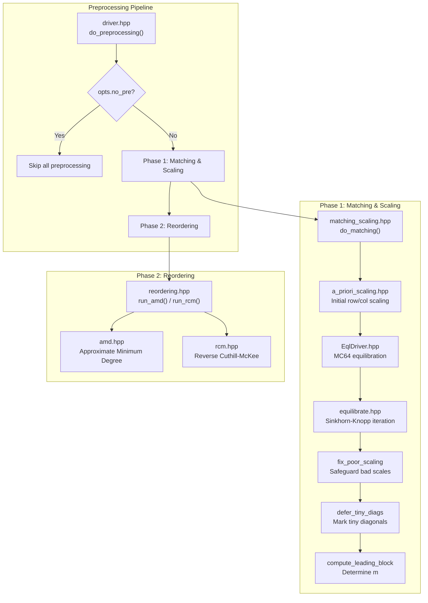

# Preprocessing Module (`pre/`)

> **Source**: `src/hif/pre/`
> **Dependencies**: `ds/` (CRS, CCS, PermMatrix), `utils/` (logging, timing, common)

## 1. Overview

The `pre/` module implements the preprocessing pipeline that transforms the
input matrix before factorization. Preprocessing improves diagonal dominance,
conditioning, and sparsity structure to produce higher-quality incomplete
factors.



## 2. Files

| File | Purpose |
|------|---------|
| `driver.hpp` | Top-level orchestrator: `do_preprocessing()` dispatches matching/scaling and reordering |
| `matching_scaling.hpp` | `do_matching()`: coordinates the scaling pipeline |
| `EqlDriver.hpp` | MC64 equilibration driver: wraps the MC64-style matching algorithm |
| `equilibrate.hpp` | Sinkhorn-Knopp equilibration: iterative row/column scaling |
| `a_priori_scaling.hpp` | Initial a priori scaling based on row/column norms |
| `reordering.hpp` | Reordering dispatcher: selects AMD or RCM based on matrix properties |
| `amd.hpp` | Approximate Minimum Degree ordering implementation |
| `rcm.hpp` | Reverse Cuthill-McKee ordering implementation |

## 3. Preprocessing Driver

**File**: `driver.hpp`

`do_preprocessing()` is the single entry point called from the factorization
kernels (`level_factorize`, `pivot_level_factorize`, `symm_level_factorize`).

### Signature

```cpp
template <class MatType, class PermType>
void do_preprocessing(
    const MatType& A,        // Input matrix (CRS or CCS)
    MatType& SA,             // Output: scaled/permuted matrix
    PermType& p,             // Output: row permutation
    PermType& q,             // Output: column permutation
    array_type& s,           // Output: row scaling
    array_type& t,           // Output: column scaling
    size_type& m,            // Output: leading block size
    const Options& opts,     // Configuration
    size_type cur_level      // Current multilevel level
);
```

### Control Flags

| Flag | Effect |
|------|--------|
| `opts.no_pre = 1` | Skip all preprocessing (identity permutation, unit scaling) |
| `opts.pre_scale = 0` | Skip matching/scaling (reordering only) |
| `opts.reorder = OFF` | Skip reordering (scaling only) |
| `opts.reorder = AUTO` | Auto-select AMD or RCM based on symmetry and deferrals |

## 4. Phase 1: Matching and Scaling

### 4.1 A Priori Scaling

**File**: `a_priori_scaling.hpp`

Computes initial row and column scaling based on the infinity norm of each
row and column:

$$s_i = 1 / \|A_{i,:}\|_\infty, \quad t_j = 1 / \|A_{:,j}\|_\infty$$

This normalizes the matrix so that the largest entry in each row and column
is approximately 1.

### 4.2 MC64 Equilibration

**File**: `EqlDriver.hpp`, `equilibrate.hpp`

The MC64 algorithm computes a maximum weight matching in the bipartite graph
of the matrix, producing a permutation and scaling that maximizes the product
of diagonal entries.

The equilibration uses the Sinkhorn-Knopp iteration:
1. Scale rows so each row sums to 1
2. Scale columns so each column sums to 1
3. Repeat until convergence

**Safeguard**: `fix_poor_scaling()` prevents extreme scaling values that
could amplify roundoff errors. The safeguard factor is controlled by
`opts.beta` (default: 1e3).

### 4.3 Static Deferral

**File**: `matching_scaling.hpp`

After equilibration, `defer_tiny_diags()` identifies diagonal entries that
are too small (below a threshold) and marks them for deferral to the Schur
complement. This is the **static** deferral mechanism, complementing the
**dynamic** deferral in the Crout loop.

`compute_leading_block()` determines the leading block size $m$ — the number
of rows/columns that will be processed by the Crout ILU before forming the
Schur complement.

## 5. Phase 2: Reordering

### 5.1 Reordering Selection

**File**: `reordering.hpp`

The reordering method is selected based on matrix properties:

| Condition | Method | Rationale |
|-----------|--------|-----------|
| `opts.reorder = AMD` | AMD | Default; good for general unsymmetric matrices |
| `opts.reorder = RCM` | RCM | Band-reducing; good for symmetric matrices |
| `opts.reorder = AUTO` + symmetric first level with deferrals | RCM | RCM preserves symmetry better |
| `opts.reorder = AUTO` + other | AMD | AMD minimizes fill-in for general matrices |
| `opts.reorder = OFF` | Identity | No reordering |

### 5.2 AMD (Approximate Minimum Degree)

**File**: `amd.hpp`

AMD ordering minimizes fill-in during factorization by eliminating vertices
with the fewest neighbors first. The implementation follows the standard
AMD algorithm with aggressive absorption.

**Effect**: Reduces the number of nonzeros in $L$ and $U$, improving both
memory usage and factorization time.

### 5.3 RCM (Reverse Cuthill-McKee)

**File**: `rcm.hpp`

RCM ordering reduces the bandwidth of the matrix by performing a BFS from
a peripheral vertex and reversing the resulting ordering.

**Effect**: Produces a banded structure that is favorable for symmetric
factorization, especially when combined with static deferral.

## 6. Symmetric vs. Asymmetric Preprocessing

The preprocessing pipeline adapts based on the pattern symmetry of the input:

| Property | Symmetric Path | Asymmetric Path |
|----------|---------------|-----------------|
| **Symmetry check** | Pattern symmetry ratio $\geq$ `nzp_thres` (0.65) | Below threshold |
| **Scaling** | Symmetric: $s = t$ (same row/col scaling) | Independent row/col scaling |
| **Reordering** | RCM preferred (preserves symmetry) | AMD preferred (minimizes fill) |
| **Permutation** | $P = Q$ (same row/col permutation) | $P \neq Q$ (independent) |

The symmetry check is performed at the beginning of `level_factorize` and
passed to `do_preprocessing` via the `is_symm_pre` flag.

## 7. Level-Specific Behavior

Preprocessing behavior varies by multilevel level:

| Level | Behavior |
|-------|----------|
| **Level 1** | Full preprocessing: matching + scaling + reordering. Row/col sizes computed from input. |
| **Level 2+** | Simplified: scaling may be skipped if `rf_par` disables parameter refinement. Reordering still applied. |
| **Last level** | No preprocessing (dense factorization handles the Schur complement directly). |

## 8. Configuration Parameters

| Parameter | Default | Effect |
|-----------|---------|--------|
| `opts.no_pre` | 0 | Set to 1 to skip all preprocessing |
| `opts.pre_scale` | 0 | Set to 1 to enable matching/scaling |
| `opts.reorder` | 2 (AMD) | Reordering method: OFF(0), AUTO(1), AMD(2), RCM(3) |
| `opts.beta` | 1e3 | Safeguard factor for equilibration scaling |
| `opts.nzp_thres` | 0.65 | Pattern symmetry threshold for symmetric preprocessing |
| `opts.symm_pre_lvls` | -2 | Number of levels using symmetric preprocessing (negative = auto) |

## 9. Cross-Module Dependencies

| From `pre/` | To Module | What |
|-------------|-----------|------|
| `driver.hpp` | `ds/` | `CRS`, `CCS`, `PermMatrix`, `BiPermMatrix` |
| `matching_scaling.hpp` | `ds/` | `Array`, `CRS`, `CCS` |
| `EqlDriver.hpp` | `ds/` | `Array`, `CRS` |
| `equilibrate.hpp` | `ds/` | `Array` |
| `reordering.hpp` | `ds/` | `PermMatrix`, `CRS`, `CCS` |
| `amd.hpp` | `ds/` | `Array` |
| `rcm.hpp` | `ds/` | `Array` |
| All | `utils/` | `log.hpp`, `Timer.hpp`, `common.hpp` |

| Consumer | From `pre/` |
|----------|-------------|
| `alg/factor.hpp` | `do_preprocessing()` |
| `alg/pivot_factor.hpp` | `do_preprocessing()` |
| `alg/symm_factor.hpp` | `do_preprocessing()` |
