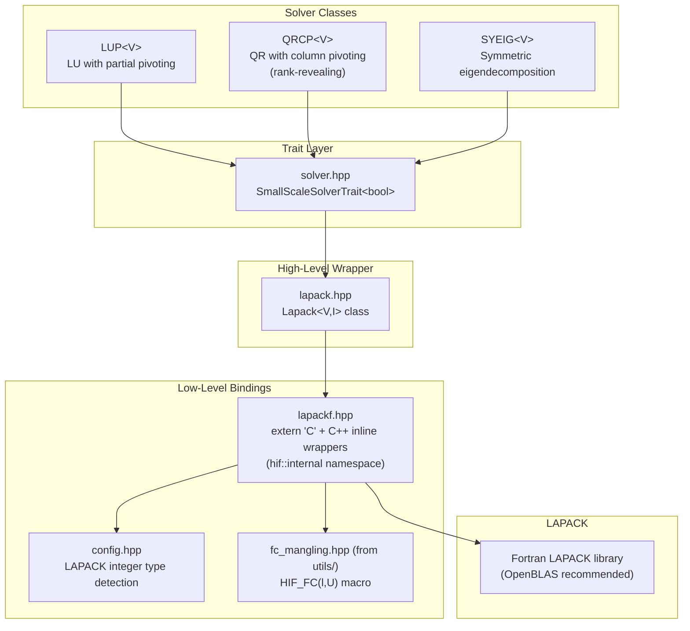

# Dense Linear Algebra Module (`small_scale/`)

> **Source**: `src/hif/small_scale/`
> **Dependencies**: `ds/` (DenseMatrix, Array), `utils/` (log, math, common, fc_mangling)

## 1. Overview

The `small_scale/` module provides dense linear algebra solvers for the
last-level Schur complement. It wraps LAPACK routines through a layered
architecture that handles Fortran name mangling, integer type bridging,
and precision dispatch.



## 2. Layered Architecture

### 2.1 Layer 1: Configuration (`config.hpp`)

Detects the LAPACK integer type at compile time:

| LAPACK Provider | Detection | `hif_lapack_int` |
|-----------------|-----------|-------------------|
| Intel MKL | `HIF_HAS_MKL` defined | `MKL_INT` |
| OpenBLAS | `OPENBLAS_CONFIG_H` or `CBLAS` headers | `openblas_int` |
| Generic | Fallback | `lapack_int` |

This typedef ensures correct integer sizes when calling Fortran LAPACK
from C++.

### 2.2 Layer 2: Fortran Bindings (`lapackf.hpp`)

Provides `extern "C"` declarations and C++ inline wrappers in the
`hif::internal` namespace for 10 LAPACK/BLAS routines across 4 precisions
(s, d, c, z):

| Routine | Purpose | Precisions |
|---------|---------|------------|
| `getrf` | LU factorization with partial pivoting | s, d, c, z |
| `getrs` | LU solve (forward/backward substitution) | s, d, c, z |
| `geqp3` | QR with column pivoting | s, d, c, z |
| `trcon` | Triangular condition estimation (1-norm) | s, d, c, z |
| `ormqr`/`unmqr` | Apply Householder reflectors | s, d, c, z |
| `laic1` | Incremental condition estimation (2-norm) | s, d, c, z |
| `syev`/`heev` | Symmetric/Hermitian eigendecomposition | s, d, c, z |
| `gemv` | General matrix-vector product | s, d, c, z |
| `trsv` | Triangular solve | s, d, c, z |
| `trmv` | Triangular matrix-vector product | s, d, c, z |

Fortran name mangling is handled by `HIF_FC(l, U)` from `utils/fc_mangling.hpp`,
which auto-detects the mangling convention (lowercase with/without underscore,
uppercase, CBLAS, LAPACKE, OpenBLAS).

### 2.3 Layer 3: High-Level Wrapper (`lapack.hpp`)

`Lapack<ValueType, IntType>` provides static methods that accept HIFIR's
`DenseMatrix` and `Array` types directly, handling:

- **Integer type bridging**: When `IntType != hif_lapack_int`, creates intermediate conversion buffers using SFINAE (`std::enable_if`)
- **Convenience overloads**: Methods accept `DenseMatrix<V>` and `Array<V>` instead of raw pointers
- **Error checking**: Validates LAPACK `info` return codes

### 2.4 Layer 4: Solver Classes

Three solver classes share a uniform interface:

```cpp
class Solver {
    void set_matrix(DenseMatrix<V>& A);
    void factorize(const Options& opts);
    void refactorize(const Options& opts);
    void solve(Array<V>& x, size_type rank, bool tran);
    void multiply(Array<V>& x, size_type rank, bool tran);
    void solve_mrhs(DenseMatrix<V>& B, size_type rank);
};
```

## 3. LUP — LU with Partial Pivoting

**File**: `LUP.hpp`

Standard dense LU factorization using LAPACK's `?getrf` (partial pivoting).

### Operations

| Method | LAPACK | Description |
|--------|--------|-------------|
| `factorize()` | `?getrf` | Compute $PA = LU$ |
| `solve()` | `?getrs` | Solve $Ax = b$ via forward/backward substitution |
| `multiply()` | `?gemv` | Compute $y = Ax$ or $y = A^T x$ |
| `refactorize()` | `?getrf` | Re-factorize with updated matrix |
| `solve_mrhs()` | `?getrs` | Solve $AX = B$ for multiple right-hand sides |

### When Used

LUP is the default dense solver when `HIF_DENSE_MODE ≠ 1`. It is efficient
for well-conditioned dense Schur complements but does not handle rank
deficiency.

## 4. QRCP — Rank-Revealing QR with Column Pivoting

**File**: `QRCP.hpp`

Rank-revealing QR factorization using LAPACK's `?geqp3` (QR with column
pivoting). This is the **default** dense solver (`HIF_DENSE_MODE = 1`).

### Rank Determination

QRCP implements two rank-determination strategies:

#### 2-Norm Based (Default)

Uses LAPACK's `?laic1` for incremental condition estimation, adapted from
the DGELSY driver:

1. Factorize: $AP = QR$ via `?geqp3`
2. Starting from rank $r = n$, estimate $\sigma_{\min}(R_{1:r,1:r})$
3. If $\sigma_{\min} < \text{threshold}$, decrement $r$ and repeat
4. Truncate to final rank $r$

#### 1-Norm Based

Uses `?trcon` for 1-norm condition estimation:

1. Factorize: $AP = QR$ via `?geqp3`
2. Estimate $\kappa_1(R_{1:r,1:r})$ via `?trcon`
3. If $\kappa_1 > \text{threshold}$, decrement $r$ and repeat

Enabled via `HIF_TQRCP_USE_1NORM` compile flag.

### Solve Algorithm

```
1. Compute Q^T * b  (via ?ormqr)
2. Solve R * z = Q^T * b  (via ?trsv, using rank r)
3. Compute x = P * z  (apply column permutation)
```

### Multiply Algorithm

```
1. Compute z = P^T * x  (apply inverse permutation)
2. Compute y = R * z  (via ?trmv, using rank r)
3. Compute result = Q * y  (via ?ormqr)
```

### Why QRCP is Default

QRCP handles rank-deficient dense Schur complements gracefully by truncating
to the numerical rank. This is essential for nearly singular systems where
the Schur complement may be rank-deficient.

## 5. SYEIG — Symmetric Eigendecomposition

**File**: `SYEIG.hpp`

Symmetric/Hermitian eigendecomposition using LAPACK's `?syev` (real) or
`?heev` (complex).

### Three Modes

| Mode | Condition | Behavior |
|------|-----------|----------|
| **SPD** (positive definite) | `opts.spd > 0` | Truncate small/negative eigenvalues from top |
| **NSD** (negative semi-definite) | `opts.spd < 0` | Reverse eigenvalue order, truncate from bottom |
| **Indefinite** | `opts.spd = 0` | Sort by magnitude, truncate smallest |

### Rank Truncation

After eigendecomposition $A = Q \Lambda Q^T$:
1. Sort eigenvalues by the appropriate criterion (mode-dependent)
2. Determine rank $r$ by truncating eigenvalues below threshold
3. Solve: $x = Q_r \Lambda_r^{-1} Q_r^T b$ (using only the top $r$ eigenvectors)

### Solve Algorithm

```
1. Compute z = Q^T * b  (via ?gemv)
2. Scale: z_i /= lambda_i  (for i = 1..r)
3. Zero: z_i = 0  (for i = r+1..n)
4. Compute x = Q * z  (via ?gemv)
```

## 6. Solver Trait

**File**: `solver.hpp`

`SmallScaleSolverTrait<UseQRCP>` is a compile-time trait that selects the
dense solver:

```cpp
template <bool UseQRCP>
struct SmallScaleSolverTrait;

template <>
struct SmallScaleSolverTrait<true> {
    template <class V> using type = QRCP<V>;
};

template <>
struct SmallScaleSolverTrait<false> {
    template <class V> using type = LUP<V>;
};
```

The trait is used in `Prec.hpp` to resolve the dense solver type:

```cpp
using sss_solver_type = typename SmallScaleSolverTrait<HIF_DENSE_MODE == 1>
    ::template type<last_level_type>;
```

### Customization

Users can override the default solver by:
1. Specializing `DefaultDenseSolver<T>` for custom value types
2. Providing a `UserDenseFactor` template parameter to `HIF<>`

## 7. Configuration Parameters

| Parameter / Macro | Default | Effect |
|-------------------|---------|--------|
| `HIF_DENSE_MODE` | 1 | Dense backend: 1=QRCP, other=LUP |
| `HIF_TQRCP_USE_1NORM` | off | Use 1-norm (trcon) instead of 2-norm (laic1) for rank determination |
| `opts.rrqr_cond` | 0.0 | RRQR condition number threshold (0 = auto) |
| `opts.spd` | 0 | SPD-ness for SYEIG: 0=indefinite, >0=PD, <0=ND |
| `opts.dense_thres` | 2000 | Size threshold for converting Schur to dense |

## 8. Cross-Module Dependencies

| From `small_scale/` | To Module | What |
|---------------------|-----------|------|
| `config.hpp` | `utils/` | `fc_mangling.hpp` (HIF_FC macro) |
| `lapackf.hpp` | `utils/` | `fc_mangling.hpp` |
| `lapack.hpp` | `ds/` | `DenseMatrix`, `Array` |
| `lapack.hpp` | `utils/` | `log.hpp`, `math.hpp` |
| `QRCP.hpp` | `ds/` | `DenseMatrix`, `Array` |
| `QRCP.hpp` | `utils/` | `common.hpp`, `math.hpp` |
| `SYEIG.hpp` | `ds/` | `DenseMatrix`, `Array` |
| `SYEIG.hpp` | `utils/` | `common.hpp`, `math.hpp` |

| Consumer | From `small_scale/` |
|----------|---------------------|
| `alg/Prec.hpp` | `solver.hpp` (SmallScaleSolverTrait), all solver classes |
| `alg/factor.hpp` | Indirectly via Prec |
