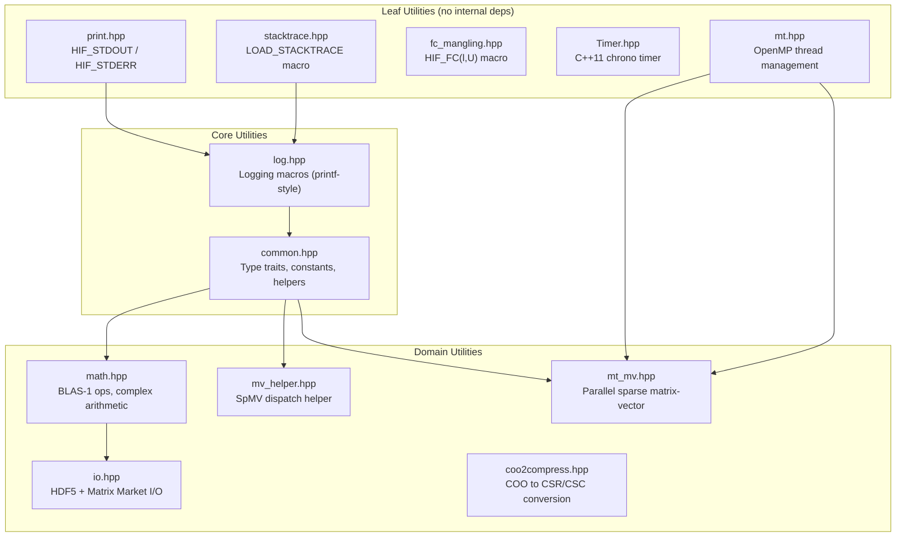

# Utilities Module (`utils/`)

> **Source**: `src/hif/utils/`
> **Dependencies**: `ds/Array.hpp` (for `coo2compress.hpp`), system libraries (OpenMP, chrono, backtrace)

## 1. Overview

The `utils/` module provides cross-cutting utilities used throughout the
entire HIFIR codebase: logging, type traits, math operations, I/O,
multithreading, timing, and format conversion.



## 2. Files

| File | Key Symbols | Purpose |
|------|------------|---------|
| `print.hpp` | `HIF_STDOUT`, `HIF_STDERR` | Hookable output streams |
| `stacktrace.hpp` | `LOAD_STACKTRACE` | Demangled C++ backtraces |
| `fc_mangling.hpp` | `HIF_FC(l, U)` | Fortran name mangling |
| `log.hpp` | `hif_info`, `hif_warning`, `hif_error`, `hif_error_if`, `hif_assert` | Logging framework |
| `common.hpp` | `ValueTypeTrait`, `Const<T>`, `find_sorted`, `rotate_left/right` | Type traits and helpers |
| `math.hpp` | `conjugate`, `inner`, `norm2`, `normalize` | BLAS-1 vector operations |
| `io.hpp` | `read_mm_sparse`, `write_mm_sparse`, `read_bin`, `write_bin` | Matrix Market and HDF5 I/O |
| `mt.hpp` | `get_nthreads`, `uniform_partition` | OpenMP thread management |
| `mt_mv.hpp` | `multiply_nt`, `multiply_mrhs_nt` | Parallel sparse matrix-vector |
| `mv_helper.hpp` | `multiply()` | Unified SpMV dispatch |
| `Timer.hpp` | `Timer<Clock, Rep>`, `DefaultTimer` | C++11 chrono-based timer |
| `coo2compress.hpp` | `convert_coo2cs()` | COO to CSR/CSC conversion |

## 3. Logging System

**File**: `log.hpp`

All logging uses **printf-style format strings** (never C++ streams).

### Macros

| Macro | Purpose | Behavior |
|-------|---------|----------|
| `hif_info(fmt, ...)` | Progress/status messages | Prints to stdout; no file/line context |
| `hif_warning(fmt, ...)` | Non-fatal anomalies | Prints to stderr with ANSI yellow "WARNING!", file/function/line |
| `hif_warning_if(cond, fmt, ...)` | Conditional warning | Warns only if `cond` is true |
| `hif_error(fmt, ...)` | Unrecoverable errors | Prints to stderr with ANSI red "ERROR!", stack trace, then `abort()` (or throws if `HIF_THROW`) |
| `hif_error_if(cond, fmt, ...)` | Input/precondition validation | Aborts/throws only if `cond` is true; condition is stringified |
| `hif_assert(cond, fmt, ...)` | Internal invariant checks | Active in debug builds only; **complete no-op in release** |

### Verbosity Gating

`hif_info` messages should be guarded with verbosity checks:

```cpp
if (hif_verbose(LVL, opts)) hif_info("message...");
```

| Level | Value | Description |
|-------|-------|-------------|
| `WARN` | 1 | Warnings only |
| `INFO` | 2 | General progress info |
| `PRE` | 4 | Preprocessing details |
| `FAC` | 8 | Factorization/Crout step details |
| `PRE_TIME` | 16 | Preprocessing timing |
| `MEM` | 32 | Memory debugging |
| `INFO2` | 64 | Very detailed info |

Levels are combined as a bitmask: `verbose = WARN | INFO | FAC` enables
warnings, general info, and factorization details.

### Format Specifiers

| Specifier | Type |
|-----------|------|
| `%d` | `int` |
| `%zd` | `size_t` |
| `%td` | `ptrdiff_t` |
| `%g` | `double` |
| `%s` | C-string |

### Output Hooks

`HIF_STDOUT` and `HIF_STDERR` (from `print.hpp`) default to `std::cout`
and `std::cerr` but can be overridden for MEX/Python bindings.

## 4. Type Traits and Constants

**File**: `common.hpp`

### ValueTypeTrait\<T\>

Provides compile-time type introspection for scalar types:

| Member | Description |
|--------|-------------|
| `type` | Underlying scalar type (strips complex wrapper) |
| `signature` | Character code: `'d'` (double), `'s'` (single), `'l'` (long double) |
| `is_complex` | Whether T is `std::complex<...>` |

### Const\<T\>

Provides machine constants and sentinel values:

| Constant | Description |
|----------|-------------|
| `ZERO` | `T(0)` |
| `ONE` | `T(1)` |
| `EPS` | Machine epsilon (`std::numeric_limits`) |
| `MIN` | Smallest positive normalized value |
| `MAX` | Largest representable value |

### ValueTypeMixedTrait\<T\>

Provides mixed-precision type mapping (e.g., `double` → `long double`
for high-precision solve when `HIF_HIGH_PRECISION_SOLVE` is enabled).

### Algorithm Helpers

| Function | Purpose |
|----------|---------|
| `find_sorted(arr, val)` | Binary search in sorted array |
| `rotate_left(arr, n)` | Cyclic left rotation |
| `rotate_right(arr, n)` | Cyclic right rotation |
| `ensure_type_consistency()` | Runtime type consistency check |

## 5. Math Utilities

**File**: `math.hpp`

BLAS-1 style vector operations and complex arithmetic support:

| Function | Description |
|----------|-------------|
| `conjugate(x)` | Complex conjugate (identity for real types) |
| `inner(x, y, n)` | Dot product $\sum x_i \bar{y}_i$ |
| `norm2_sq(x, n)` | Squared Euclidean norm $\sum |x_i|^2$ |
| `norm2(x, n)` | Overflow-safe Euclidean norm (max-magnitude scaling) |
| `normalize(x, n)` | In-place normalization: $x \leftarrow x / \|x\|_2$ |
| `normalize2(x, n)` | Normalize and return norm value |

### Mixed-Type Complex Arithmetic

Overloaded operators (`+`, `-`, `*`, `/`) for mixed real/complex arithmetic,
enabling expressions like `double * complex<double>` without explicit casts.

## 6. I/O

**File**: `io.hpp`

### Matrix Market

| Function | Description |
|----------|-------------|
| `read_mm_sparse(fname, mat)` | Read sparse matrix from Matrix Market file |
| `read_mm_vector(fname, vec)` | Read vector from Matrix Market file |
| `write_mm_sparse(fname, mat)` | Write sparse matrix to Matrix Market file |
| `write_mm_vector(fname, vec)` | Write vector to Matrix Market file |

Supports: general, symmetric, Hermitian, skew-symmetric; real and complex.

### HDF5 (Conditional)

| Function | Description |
|----------|-------------|
| `write_bin(fname, mat)` | Write sparse matrix in HDF5 binary format |
| `read_bin(fname, mat)` | Read sparse matrix from HDF5 binary format |

Enabled when `HIF_HAS_HDF5` is defined (requires HDF5 library at compile time).

## 7. Multithreading

**File**: `mt.hpp`

### Thread Management

| Function | Description |
|----------|-------------|
| `get_nthreads(opts)` | Get thread count: checks `opts.threads`, then `HIF_NUM_THREADS` env, then `OMP_NUM_THREADS` env, then `omp_get_max_threads()` |
| `get_thread()` | Get current thread ID |
| `uniform_partition(n, nthreads)` | Partition `n` items uniformly across `nthreads` threads |

### Parallel Sparse Matrix-Vector

**File**: `mt_mv.hpp`

| Function | Description |
|----------|-------------|
| `multiply_nt(A, x, y, tran)` | Parallel SpMV: $y = Ax$ or $y = A^T x$ |
| `multiply_mrhs_nt(A, X, Y, tran)` | Parallel SpMV with multiple right-hand sides |

**Auto-disable**: Threading is disabled for small matrices (< 1000 rows or
$\leq$ 20 nnz/row) where overhead exceeds benefit.

**Format dispatch**: CRS uses parallel row-wise computation; CCS falls
back to serial (column-wise access pattern is less cache-friendly for SpMV).

### SpMV Dispatch Helper

**File**: `mv_helper.hpp`

`multiply(A, x, y, tran)` dispatches to either:
- `A.multiply(x, y, tran)` for sparse matrix types
- `std::function` callback for user-provided matrix-free operators

## 8. Timer

**File**: `Timer.hpp`

C++11 `<chrono>`-based timer:

```cpp
Timer<> timer;
timer.start();
// ... work ...
timer.finish();
double elapsed = timer.time();        // seconds
double ms = timer.time_milli();       // milliseconds
double us = timer.time_micro();       // microseconds
double ns = timer.time_nano();        // nanoseconds
```

| Clock Type | Description |
|------------|-------------|
| `SYSTEM` | `std::chrono::system_clock` (wall clock) |
| `HIGH_RES` | `std::chrono::high_resolution_clock` |

`DefaultTimer` uses `HIGH_RES` clock with `double` representation.

## 9. COO to Compressed Storage

**File**: `coo2compress.hpp`

`convert_coo2cs()` converts COO (coordinate) format to CSR or CSC:

1. Count entries per row (CSR) or column (CSC)
2. Compute prefix sums for `indptr`
3. Scatter entries into `indices` and `vals` arrays
4. Sort indices within each row/column

Used when loading matrices from Matrix Market files (which store in COO format).

## 10. Fortran Name Mangling

**File**: `fc_mangling.hpp`

`HIF_FC(lowercase, UPPERCASE)` macro resolves Fortran symbol names for
linking C++ to LAPACK/BLAS:

| Convention | Detection | Result |
|------------|-----------|--------|
| Lowercase + underscore | Default | `dgetrf_` |
| Lowercase, no underscore | `HIF_FC_NO_UNDERSCORE` | `dgetrf` |
| Uppercase | `HIF_FC_UPPERCASE` | `DGETRF` |
| CBLAS | `CBLAS` headers detected | `cblas_dgemv` |
| LAPACKE | `LAPACKE` headers detected | `LAPACKE_dgetrf` |
| OpenBLAS | `OPENBLAS` detected | `openblas_dgetrf` |

## 11. Stack Traces

**File**: `stacktrace.hpp`

`LOAD_STACKTRACE(ss, limit)` macro captures demangled C++ backtraces:

- **GCC/Unix**: Uses `backtrace()` + `abi::__cxa_demangle()` for readable C++ symbol names
- **Other platforms**: No-op (empty string)

Stack traces are included in `hif_error` messages automatically.

## 12. Cross-Module Usage

The `utils/` module is the most widely used module in HIFIR (55 includes from 30+ files):

| Consumer Module | Utilities Used |
|-----------------|----------------|
| `ds/` | `common`, `coo2compress`, `io`, `math`, `mt_mv`, `log` |
| `alg/` | `common`, `log`, `Timer`, `math`, `mv_helper` |
| `pre/` | `Timer`, `common`, `log` |
| `small_scale/` | `log`, `math`, `common`, `fc_mangling` |
| `builder.hpp` | `common`, `mt` |
| `NspFilter.hpp` | `common`, `log` |
